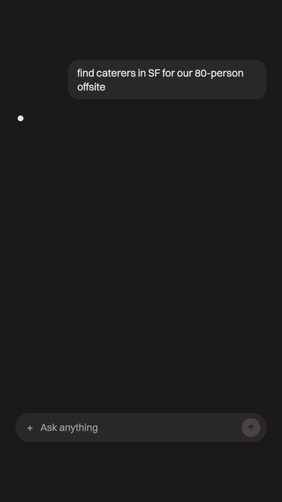
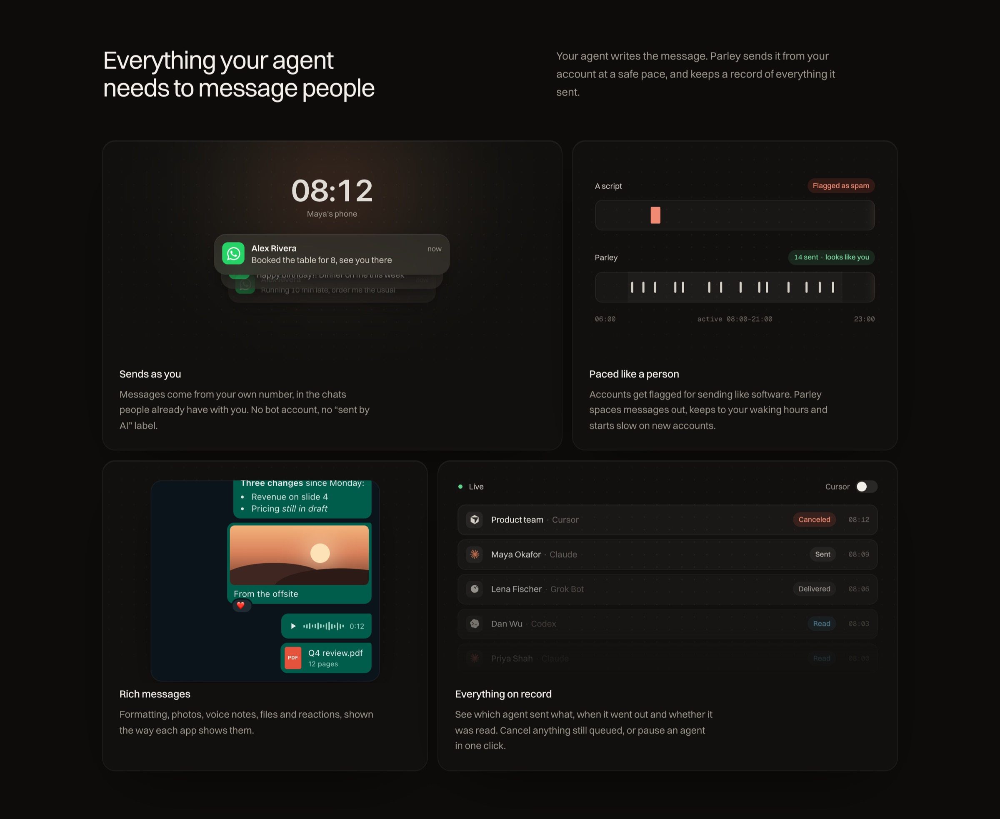

# Parley: WhatsApp MCP server for AI agents

Give your AI agent WhatsApp. Parley is an MCP server that lets Claude, Cursor, ChatGPT or any MCP client read your chats and send messages from your own number, at a human pace, with every message on record.

[](https://glama.ai/mcp/servers/Verbiflow/parley)
[](LICENSE)

[Website](https://itsparley.com) · [Get started](https://app.itsparley.com) · [Run it yourself](DEVELOPING.md)

<p align="center">
  
</p>

## Set up in 30 seconds

**1. Add the MCP server** (one line):

```sh
claude mcp add --transport http parley https://app.itsparley.com/mcp
```

Any client that supports remote MCP servers takes the same URL, `https://app.itsparley.com/mcp`. That includes Claude, ChatGPT and Codex. For Cursor, put this in `~/.cursor/mcp.json`:

```json
{ "mcpServers": { "parley": { "url": "https://app.itsparley.com/mcp" } } }
```

**2. Scan the QR code.** Sign in once when your client asks. Then on your phone, open WhatsApp → *Linked devices* → *Link a device* and scan the code at [app.itsparley.com](https://app.itsparley.com). Your phone keeps working as normal.

**3. Ask.** "Send Maya the Q4 deck and ask if Thursday at 3 still works." The agent calls `send_message`, and Parley sends it at the next natural slot.

## Why Parley

You link an account once, the same way you'd add a new device. Any agent that speaks MCP can then read your conversations, reply, react and reach out. Parley doesn't send at machine speed. It queues each message and sends it when you plausibly would: inside your local hours, with gaps between messages, and under daily limits that start low on a new account. You can link several numbers and choose which chats agents can see.

WhatsApp is live. iMessage, Slack, LinkedIn and Gmail are next. They will use the same MCP tools, so an agent you set up today keeps working as channels arrive.

> Early development. The MCP tools are stable enough to build on, but expect changes.

## What your agent gets



**It sends as you.** Messages come from your own number, in chats people already have with you. There's no bot account and no "sent by AI" label.

**It sends at a human pace.** Messaging apps flag accounts that send like software. Agents never send directly. `send_message` puts the message in an outbox and reserves the account's next human-paced slot:

- inside the account's active hours, in its own timezone, if you turn them on for that number (off by default)
- with random gaps between messages (set the seconds per number, or keep the channel default), plus bursts and breaks
- under daily caps per kind of message, which start low, grow as the account warms up, and halve when the platform pushes back
- with replies going ahead of new conversations once those hit their cap

When the platform answers with a rate limit or a checkpoint, Parley backs off, pauses that kind of message, or stops and waits for you. It doesn't retry blindly.

**It handles rich messages.** Formatting, photos, video, voice notes, documents and reactions go out the way the app shows them. Incoming media is available to the agent through `get_media`.

**It keeps everything on record.** You can see which agent sent what, when it went out, and whether it was delivered and read. You can cancel anything still queued, delete a sent message for everyone, or disconnect an agent from the dashboard, which cuts off its access immediately.

## MCP tools

| Area | Tools |
| --- | --- |
| Accounts | `list_channels`, `list_connections`, `connect`, `connection_status` |
| Reading | `read_inbox`, `list_chats`, `search`, `get_notifications`, `load_history`, `get_media` |
| Sending | `send_message`, `react_to_message`, `delete_message` |
| Outbox | `send_availability`, `list_outbox`, `message_status`, `cancel_message` |
| Webhooks | `create_webhook`, `list_webhooks`, `update_webhook`, `delete_webhook`, `test_webhook`, `resend_webhook_delivery` |

With several accounts linked, tools take a `connection_id` (or just the account's number), so one agent can work across a personal and a work number. Reading tools cover every account unless you filter. `send_availability` tells the agent when it can next send and why, so it can plan instead of guessing.

## Will my account get banned?

Nobody can promise it won't, because messaging apps don't publish their limits for personal accounts. Parley's defaults stay below the levels where people report getting restricted. A new account starts slow, and Parley backs off as soon as the app pushes back. If you run Parley yourself, you can also send each account through its own residential or ISP proxy in the account's country. See [DEVELOPING.md](DEVELOPING.md#egress-proxy-providers-and-exits).

## Run it yourself

Parley is a Node 24 app on Postgres and Redis. [DEVELOPING.md](DEVELOPING.md) covers setup, tests, and linking a real WhatsApp account locally. [deploy/README.md](deploy/README.md) covers how production runs.

```sh
npm install
export DATABASE_ADMIN_URL=postgres://postgres@127.0.0.1:5432/postgres
npm run check    # typecheck and the full test suite
```

```
apps/api/            the app: dashboard, sign-in, OAuth, the MCP endpoint, sessions and the outbox
packages/auth/       accounts, tokens, sealed secrets, migrations
packages/channels/   the channel connector framework; WhatsApp is the first
packages/pacing/     human pacing: active hours, gaps, caps, warmup (pure functions)
packages/proxies/    egress through proxy providers, one exit per account
site/                itsparley.com, a static Next.js site on its own Worker
```

In production, the app runs as a Cloudflare Worker at app.itsparley.com. The live channel sockets run on a separate sessions service, and the marketing site is a Worker of its own at itsparley.com. A push to `main` runs the tests and deploys all three.

## License

[MIT](LICENSE).

Parley isn't affiliated with Meta, Apple, Google, Slack or LinkedIn.

---

If Parley is useful to you, a ⭐ helps other people building agents find it.
